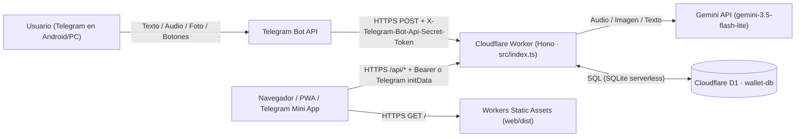

# Arquitectura, Infraestructura y Flujo de Trabajo — Gasti Personal

Este documento explica cómo funciona el proyecto por dentro, qué servicios de **Cloudflare** y **Google** utiliza, cuáles son los límites del plan gratuito (\$0/mes), cómo se protege tu información y cuál es el flujo riguroso de desarrollo, versionado y despliegue a producción.

---

## 1. Visión general de la arquitectura

Todo el sistema corre de manera **serverless** (bajo demanda: no hay servidores encendidos 24/7 ni bases de datos en máquinas virtuales).

### ¿Qué pasa en cada flujo?
1. **Cuando mandás un mensaje por Telegram:**
   - Telegram envía un POST a `https://<tu-worker>.workers.dev/webhook/telegram`.
   - El Worker verifica de forma *fail-closed* el header secreto (`TELEGRAM_WEBHOOK_SECRET`, comparación en tiempo constante vía SHA-256) y tu ID de usuario + chat privado (`ALLOWED_TELEGRAM_USER_ID`, `from.id === allowedId` y `chat.id === allowedId`), deduplica reintentos por `telegram_message_id` (`idx_transactions_telegram_message_id`), responde `200 OK` al instante para que Telegram no reintente, y procesa el mensaje en segundo plano (`waitUntil`, con un tope de 30 segundos en Cloudflare).
   - Llama a **Gemini (`gemini-3.5-flash-lite`)** con esquema JSON estricto usando **las cuentas, categorías y etiquetas reales cargadas en tu base D1** para extraer movimientos (`record`, incluidas transferencias/pagos multimoneda con `to_amount`), consultas multi-mes (`query` con `query_month`), altas de configuración y gastos fijos (`manage`: crear cuentas, tarjetas, categorías, etiquetas o recurrentes), o informar acciones reservadas al Dashboard (`unsupported`). Ver detalle completo en [Bot de Telegram y Staging](TELEGRAM_BOT.md).
   - Guarda en **D1** y te responde por Telegram con botones interactivos (`✅ OK`, `✏️ Categoría`, `🔄 Cuenta`, `🏷️ Etiquetas`, `🗑️ Borrar` / `🗑️ Eliminar`).
2. **Cuando abrís el Dashboard (PWA o Mini App):**
   - El mismo Worker sirve los archivos estáticos compilados de React (`web/dist`) sin pasar por Node ni gastar cómputo innecesario.
   - Las llamadas a `/api/*` ejecutan el Worker, validan tu identidad de forma *fail-closed* (`DASHBOARD_TOKEN` o firma criptográfica HMAC de Telegram `initData` con `auth_date` obligatorio) y consultan **D1**. En particular, `/api/bootstrap` usa `loadBootstrapSnapshot` (pushdown SQL + agregaciones en `db.batch`) para calcular saldos, resúmenes de tarjeta, `paid_statement_items`, `referencedTransactions`, historial y proyección futura dentro del límite de **10 ms CPU** del plan Workers Free.

---

## 2. Qué es cada pieza de Cloudflare (sin rodeos)

### A. Cloudflare Worker (`src/`)
- Es una función JavaScript/TypeScript que vive en la red global de Cloudflare y **solo se ejecuta durante los milisegundos en que entra una petición HTTP**.
- No usa Express ni Node.js tradicional; usa **Hono** sobre el runtime V8 de Cloudflare.
- **Ventaja:** \$0 cuando no lo usás, arranque en ~13 ms y cero mantenimiento de sistema operativo o parches.

### B. Cloudflare D1 (`migrations/`)
- Es una base de datos **SQLite administrada en la nube** (`wallet-db`).
- Incluye [`migrations/0001_initial.sql`](../migrations/0001_initial.sql) (esquema v3 limpio), [`migrations/0002_indexes.sql`](../migrations/0002_indexes.sql) (índices en `to_account_id`, `recurring_items(account_id)` y `telegram_message_id` para deduplicación de webhook) y [`migrations/0003_cards_closing_and_fx.sql`](../migrations/0003_cards_closing_and_fx.sql) (`accounts.closing_day` y `transactions.to_amount`).
- Tenés **tres ambientes completamente aislados**:
  1. **Local** (`.wrangler/state/v3/d1`): vive en tu PC; se usa al correr `npm run dev` y se actualiza con `npm run db:migrate:local`.
  2. **Staging (`[env.staging]` / `wallet-db-staging`):** Worker + D1 + segundo bot de Telegram de pruebas (`npm run db:migrate:staging` y `npm run deploy:staging`; guía en [Bot de Telegram y Staging](TELEGRAM_BOT.md)).
  3. **Remota / Producción (`wallet-db`):** vive en la nube; solo cambia si corrés `npm run db:migrate:remote` o si usás la app desplegada.
- Nunca se borra ni se pisa código de producción por probar cosas en local.

### C. Workers Static Assets (`web/dist`)
- Configurado en `wrangler.toml` (copiado de [wrangler.example.toml](../wrangler.example.toml)) bajo `[assets]`.
- Permite alojar la app web React/Vite dentro del **mismo Worker y dominio**, evitando tener otro servicio separado para el frontend.
- `run_worker_first = ["/api/*", "/webhook/*"]` garantiza que las rutas de API y webhook siempre pasen por tu lógica en TypeScript, mientras que el resto sirve el frontend.

### D. Configuración pública vs. Secretos
| Dónde vive | Qué va ahí | ¿Se sube a Git? |
| :--- | :--- | :---: |
| `[vars]` en [wrangler.example.toml](../wrangler.example.toml) → `wrangler.toml` | Configuración **no sensible**: `APP_ENV`, `DEFAULT_CURRENCY` (`ARS`, `USD` o `BRL`), `TIMEZONE`, `DASHBOARD_URL` y tu `database_id` de D1. | Plantilla sí; `wrangler.toml` **Nunca** (en `.gitignore`) |
| `.dev.vars` (copiado de [.dev.vars.example](../.dev.vars.example)) | Claves para **desarrollo local**: `GEMINI_API_KEY`, `TELEGRAM_BOT_TOKEN`, `ALLOWED_TELEGRAM_USER_ID`, `TELEGRAM_WEBHOOK_SECRET`, `DASHBOARD_TOKEN`. | **Nunca** (en `.gitignore`) |
| `npx wrangler secret put <NOMBRE>` | Claves cifradas en **producción** dentro de Cloudflare. | **Nunca** |

---

## 3. Límites del Plan Gratuito (\$0/mes) y Riesgo de Cobro

Mientras tu cuenta de Cloudflare **no tenga tarjeta de crédito asociada** y esté en el plan **Workers Free**, Cloudflare aplica límites duros: si alguna vez se alcanzara un tope diario, la petición falla temporalmente hasta el día siguiente, **no genera facturas**.

| Servicio | Límite gratuito (Free Tier) | Uso estimado (1 persona, ~150 mov/mes) | Margen |
| :--- | :--- | :--- | :--- |
| **Cloudflare Workers** | 100.000 requests/día · 10 ms CPU/request · 30 s `waitUntil` | ~10–30 requests/día | >99,9% libre |
| **Cloudflare Workers Assets** | Incluido dentro de Workers (archivos estáticos ilimitados sin costo de Worker) | Unas pocas visitas/día | >99,9% libre |
| **Cloudflare D1** | 5 GB almacenamiento · 5.000.000 filas leídas/día · 100.000 filas escritas/día | <1 MB · ~500 lecturas/día · ~10 escrituras/día | >99,9% libre |
| **Telegram Bot API** | Gratis e ilimitado | ~10–20 mensajes/día | Ilimitado |
| **Gemini API (`gemini-3.5-flash-lite`)** | Free Tier de Google AI Studio (sujeto a cuota por minuto/día de Google) | ~5–15 llamadas/día | Amplio |

> **Importante:** En desarrollo, probá siempre en local (`npm run dev`) para no gastar despliegues ni ensuciar tu base de datos D1 de producción con movimientos ficticios.

---

## 4. Seguridad y Privacidad (*Fail-Closed* en v3.1)

1. **Bloqueo estricto por usuario y chat privado:** En [src/telegram.ts](../src/telegram.ts), `ALLOWED_TELEGRAM_USER_ID` es obligatorio; todo mensaje o callback donde falte la configuración, `from.id` no coincida o el mensaje no provenga del chat privado (`chat.id === allowedId`) se descarta silenciosamente.
2. **Validación del Webhook y deduplicación:** En [src/index.ts](../src/index.ts), `POST /webhook/telegram` exige `TELEGRAM_WEBHOOK_SECRET` configurado y compara el header `X-Telegram-Bot-Api-Secret-Token` en tiempo constante vía SHA-256. Además, los reintentos de Telegram se deduplican mediante `telegram_message_id` (indexado en `idx_transactions_telegram_message_id` de [`migrations/0002_indexes.sql`](../migrations/0002_indexes.sql)).
3. **Autenticación del Dashboard:** En [src/auth.ts](../src/auth.ts), toda ruta `/api/*` (excepto `/api/health`) aplica modo *fail-closed* y exige:
   - `Authorization: Bearer <DASHBOARD_TOKEN>` (obligatorio incluso en desarrollo si no se presenta `initData`, comparado en tiempo constante vía SHA-256), **o**
   - `X-Telegram-Init-Data` verificado criptográficamente con HMAC-SHA256 usando `TELEGRAM_BOT_TOKEN`, **`auth_date` obligatorio** (expiración <= 24h) y validación estricta de `user.id === ALLOWED_TELEGRAM_USER_ID`.
4. **Configuración local y datos personales fuera de Git:** `wrangler.toml`, `.dev.vars`, `.wrangler/` y `imports/` están ignorados en [.gitignore](../.gitignore). **Nunca** subas `database_id` reales, extractos bancarios ni `.dev.vars` a un repositorio remoto.

---

## 5. Flujo Riguroso de Versionado y Despliegue

Para mantener el proyecto ordenado, seguro y evitar despliegues innecesarios a producción:

### Estrategia de ramas (Git)
- **`main`**: representa **exactamente** lo que está desplegado en producción. Nunca se edita código experimental directo en `main`.
- **`dev`**: rama de integración estable antes de pasar a `main`.
- **Ramas temáticas (`feat/*`, `test/*`, `fix/*`)**: una rama por cada nueva funcionalidad, suite de tests o corrección (detalle en [Roadmap y Próximos Pasos](ROADMAP.md)).

### Ciclo obligatorio antes de pasar a producción
1. **Desarrollar en local:**
   - Correr el entorno local (`npm run dev` + D1 local).
   - Si hay cambios de esquema, crear una **nueva migración numerada** (`migrations/0004_...sql`, nunca editar migraciones ya aplicadas como `0001_initial.sql` o `0002_indexes.sql`) y probarla primero con `npm run db:migrate:local`.
2. **Validar calidad antes de cerrar el cambio:**
   - `npm test` (todos los tests unitarios en verde).
   - `npm run build` (compilación de React + chequeo estricto de TypeScript sin errores).
   - Revisar `git diff` y confirmar que no se filtran secretos, `wrangler.toml` ni datos reales.
3. **Versionar (siempre con tu confirmación explícita):**
   - Commits claros y atómicos en la rama de trabajo.
   - Merge a `main` únicamente cuando la etapa está completa y probada.
4. **Desplegar a producción (solo desde `main`):**
   - Si hubo migraciones nuevas: `npm run db:migrate:remote`.
   - Publicar Worker + Frontend: `npm run deploy`.

---

## 6. Modelo de Datos Agnóstico (v3.1)

El esquema consolidado en [`migrations/0001_initial.sql`](../migrations/0001_initial.sql), [`migrations/0002_indexes.sql`](../migrations/0002_indexes.sql) y [`migrations/0003_cards_closing_and_fx.sql`](../migrations/0003_cards_closing_and_fx.sql) inicia **sin cuentas predefinidas** y con una base genérica editable de **22 categorías (18 de gasto + 4 de ingreso)** y **5 etiquetas**:
- **`accounts`**: cada usuario crea sus propias billeteras/bancos (`wallet`), cuentas de ahorro/reservas (`savings`), efectivo (`cash`) y tarjetas de crédito (`credit_card`) en `ARS`, `USD` o `BRL`, con color propio, flag `is_default`, cierre opcional `closing_day` (imputación por defecto a `mes + 1` / `mes + 2` según cierre) y vencimiento opcional `due_day` para alertas (`OverdueCardAlert` con `remaining_due` y `status`).
- **`transactions`**: soporta 7 tipos (`expense`, `income`, `transfer`, `investment`, `third_party`, `third_party_repayment`, `adjustment`), transferencias y pagos de tarjeta entre monedas distintas (`to_amount` / `source_amount` con imputación `cash` en moneda origen sin doble conteo), cuotas en tarjeta (`installments_total >= 2`, `first_installment_month`), `statement_month` para pagos reales de resumen (Opción B, con estado `pending`/`partial`/`paid`), `budget_month` contable opcional, terceros y compras compartidas (`linked_group_id`).
- **`tags` / `transaction_tags` / `recurring_items`**: etiquetado transversal N:M y proyección futura de cuotas + gastos fijos mensuales / suscripciones con mes de inicio (`start_month`).

Para el detalle completo de reglas contables, casos de uso, alcance del bot y evolución, consultá [Bot de Telegram y Staging](TELEGRAM_BOT.md), [Modelo de Datos y Casos de Uso](MODELO_DATOS.md), [Plan de Evolución v3 Agnóstico](PLAN_V3_AGNOSTICO.md) y [Roadmap y Próximos Pasos](ROADMAP.md).

---

## 7. Decisiones y Evolución de Invariantes (v3.1)

1. **Monedas acotadas a `ARS`, `USD`, `BRL`:** la UI y docs previas mencionaban "otras monedas" mientras el motor contable/Gemini solo operaba en `ARS`/`USD`; en v3.1 se acota y valida `ARS`, `USD` y `BRL` de extremo a extremo.
2. **Atribución de resúmenes pagados (`paid_statement_items`):** `/api/bootstrap` lee un snapshot único (`loadAllDataSnapshot`, 6 queries vía `db.batch`) y entrega `paid_statement_items` + `referencedTransactions` para que el listado filtrado coincida 100% con los gráficos bajo Opción B.
3. **Pagos parciales y múltiples de resumen (`pending` / `partial` / `paid`):** reemplaza la suposición de "1 transferencia = resumen pagado" por acumulación cronológica por `(tarjeta, statement_month)` sin desactivar alertas vencidas ni duplicar el descuento de `third_party_total`.
4. **Seguridad *fail-closed* por defecto:** `TELEGRAM_WEBHOOK_SECRET`, `ALLOWED_TELEGRAM_USER_ID`, `DASHBOARD_TOKEN`, `auth_date` obligatorio en `initData` y chat privado (`chat.id === allowedId`) son obligatorios con comparación en tiempo constante vía SHA-256.
5. **`wrangler.toml` excluido de Git:** resuelve la contradicción histórica con el repositorio trackeado y evita filtrar `database_id` o `DASHBOARD_URL` personales (ver detalle completo en [AGENTS.md](../AGENTS.md)).
