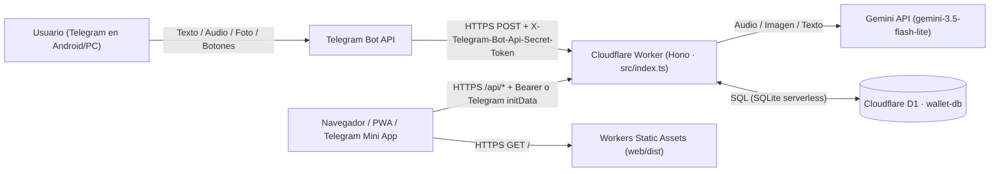

# Arquitectura, Infraestructura y Flujo de Trabajo — Gasti Personal

Este documento explica cómo funciona el proyecto por dentro, qué servicios de **Cloudflare** y **Google** utiliza, cuáles son los límites del plan gratuito (\$0/mes), cómo se protege tu información y cuál es el flujo riguroso de desarrollo, versionado y despliegue a producción.

---

## 1. Visión general de la arquitectura

Todo el sistema corre de manera **serverless** (bajo demanda: no hay servidores encendidos 24/7 ni bases de datos en máquinas virtuales).

### ¿Qué pasa en cada flujo?
1. **Cuando mandás un mensaje por Telegram:**
   - Telegram envía un POST a `https://gasti-wallet.lisandro-dev.workers.dev/webhook/telegram`.
   - El Worker verifica el header secreto (`TELEGRAM_WEBHOOK_SECRET`) y tu ID de usuario (`ALLOWED_TELEGRAM_USER_ID`), responde `200 OK` al instante para que Telegram no reintente, y procesa el mensaje en segundo plano (`waitUntil`, con un tope de 30 segundos en Cloudflare).
   - Llama a **Gemini (`gemini-3.5-flash-lite`)** con esquema JSON estricto para extraer monto, cuenta, categoría, tipo (`expense` / `income` / `transfer`) y descripción.
   - Guarda en **D1** y te responde por Telegram con botones interactivos (`✅ OK`, `✏️ Categoría`, `🔄 Cuenta`, `🗑️ Borrar`).
2. **Cuando abrís el Dashboard (PWA o Mini App):**
   - El mismo Worker sirve los archivos estáticos compilados de React (`web/dist`) sin pasar por Node ni gastar cómputo innecesario.
   - Las llamadas a `/api/*` sí ejecutan el Worker, validan tu identidad (`DASHBOARD_TOKEN` o firma criptográfica HMAC de Telegram `initData`) y consultan **D1**.

---

## 2. Qué es cada pieza de Cloudflare (sin rodeos)

### A. Cloudflare Worker (`src/`)
- Es una función JavaScript/TypeScript que vive en la red global de Cloudflare y **solo se ejecuta durante los milisegundos en que entra una petición HTTP**.
- No usa Express ni Node.js tradicional; usa **Hono** sobre el runtime V8 de Cloudflare.
- **Ventaja:** \$0 cuando no lo usás, arranque en ~13 ms y cero mantenimiento de sistema operativo o parches.

### B. Cloudflare D1 (`migrations/`)
- Es una base de datos **SQLite administrada en la nube** (`wallet-db`).
- Tenés **dos bases completamente aisladas**:
  1. **Local** (`.wrangler/state/v3/d1`): vive en tu PC; se usa al correr `npm run dev` y se actualiza con `npm run db:migrate:local`.
  2. **Remota / Producción** (en Cloudflare): vive en la nube; solo cambia si corrés `npm run db:migrate:remote` o si usás la app desplegada.
- Nunca se borra ni se pisa código de producción por probar cosas en local.

### C. Workers Static Assets (`web/dist`)
- Configurado en [wrangler.toml](../wrangler.toml) bajo `[assets]`.
- Permite alojar la app web React/Vite dentro del **mismo Worker y dominio**, evitando tener otro servicio separado para el frontend.
- `run_worker_first = ["/api/*", "/webhook/*"]` garantiza que las rutas de API y webhook siempre pasen por tu lógica en TypeScript, mientras que el resto sirve el frontend.

### D. Configuración pública vs. Secretos
| Dónde vive | Qué va ahí | ¿Se sube a Git? |
| :--- | :--- | :---: |
| `[vars]` en [wrangler.toml](../wrangler.toml) | Configuración **no sensible**: `APP_ENV`, `DEFAULT_CURRENCY`, `TIMEZONE`, `DASHBOARD_URL`. | **Sí** |
| `.dev.vars` (copiado de [.dev.vars.example](../.dev.vars.example)) | Claves para **desarrollo local**: `GEMINI_API_KEY`, `TELEGRAM_BOT_TOKEN`, `ALLOWED_TELEGRAM_USER_ID`, `TELEGRAM_WEBHOOK_SECRET`, `DASHBOARD_TOKEN`. | **Nunca** (en `.gitignore`) |
| `npx wrangler secret put <NOMBRE>` | Claves cifradas en **producción** dentro de Cloudflare. | **Nunca** |

---

## 3. Límites del Plan Gratuito (\$0/mes) y Riesgo de Cobro

Mientras tu cuenta de Cloudflare **no tenga tarjeta de crédito asociada** y esté en el plan **Workers Free**, Cloudflare aplica límites duros: si alguna vez se alcanzara un tope diario, la petición falla temporalmente hasta el día siguiente, **no genera facturas**.

| Servicio | Límite gratuito (Free Tier) | Uso estimado (1 persona, ~150 mov/mes) | Margen |
| :--- | :--- | :--- | :--- |
| **Cloudflare Workers** | 100.000 requests/día · 10 ms CPU/request · 30 s `waitUntil` | ~10–30 requests/día | >99,9% libre |
| **Cloudflare Workers Assets** | Incluido dentro de Workers (archivos estáticos ilimitados sin costo de Worker) | Unas pocas visitas/día | >99,9% libre |
| **Cloudflare D1** | 5 GB almacenamiento · 5.000.000 filas leídas/día · 100.000 filas escritas/día | <1 MB · ~500 lecturas/día · ~10 escrituras/día | >99,9% libre |
| **Telegram Bot API** | Gratis e ilimitado | ~10–20 mensajes/día | Ilimitado |
| **Gemini API (`gemini-3.5-flash-lite`)** | Free Tier de Google AI Studio (sujeto a cuota por minuto/día de Google) | ~5–15 llamadas/día | Amplio |

> **Importante:** En desarrollo, probá siempre en local (`npm run dev`) para no gastar despliegues ni ensuciar tu base de datos D1 de producción con movimientos ficticios.

---

## 4. Seguridad y Privacidad

1. **Bloqueo por usuario único:** En [src/telegram.ts](../src/telegram.ts), todo mensaje o botón cuyo `from.id` no coincida con `ALLOWED_TELEGRAM_USER_ID` se descarta silenciosamente.
2. **Validación del Webhook:** En [src/index.ts](../src/index.ts), `POST /webhook/telegram` exige el header `X-Telegram-Bot-Api-Secret-Token` igual a `TELEGRAM_WEBHOOK_SECRET`.
3. **Autenticación del Dashboard:** En [src/auth.ts](../src/auth.ts), toda ruta `/api/*` (excepto `/api/health`) exige:
   - `Authorization: Bearer <DASHBOARD_TOKEN>` (comparado en tiempo constante), **o**
   - `X-Telegram-Init-Data` verificado criptográficamente con HMAC-SHA256 usando `TELEGRAM_BOT_TOKEN`, expiración de 24h y validación de `user.id === ALLOWED_TELEGRAM_USER_ID`.
4. **Datos personales fuera de Git:** La carpeta `imports/` (donde guardaremos tus CSV/exportaciones de Wallet para analizarlos) está ignorada en [.gitignore](../.gitignore). **Nunca** subas extractos bancarios ni `.dev.vars` a un repositorio remoto.

---

## 5. Flujo Riguroso de Versionado y Despliegue

Para mantener el proyecto ordenado, seguro y evitar despliegues innecesarios a producción:

### Estrategia de ramas (Git)
- **`main`**: representa **exactamente** lo que está desplegado en producción. Nunca se edita código experimental directo en `main`.
- **`feat/<etapa>`** (o `dev`): ramas de trabajo para nuevas funcionalidades (por ejemplo `feat/modelo-datos-wallet`, `feat/importador-csv`, `feat/resumen-bbva`).

### Ciclo obligatorio antes de pasar a producción
1. **Desarrollar en local:**
   - Correr el entorno local (`npm run dev` + D1 local).
   - Si hay cambios de esquema, crear una **nueva migración numerada** (`migrations/0002_...sql`, nunca editar `0001_initial.sql` ya aplicada en producción) y probarla primero con `npm run db:migrate:local`.
2. **Validar calidad antes de cerrar el cambio:**
   - `npm test` (todos los tests unitarios en verde).
   - `npm run build` (compilación de React + chequeo estricto de TypeScript sin errores).
   - Revisar `git diff` y confirmar que no se filtran secretos ni datos reales.
3. **Versionar (siempre con tu confirmación explícita):**
   - Commits claros y atómicos en la rama de trabajo.
   - Merge a `main` únicamente cuando la etapa está completa y probada.
4. **Desplegar a producción (solo desde `main`):**
   - Si hubo migraciones nuevas: `npm run db:migrate:remote`.
   - Publicar Worker + Frontend: `npm run deploy`.

---

## 6. Modelo de Datos Actual (v1) y Próximo Paso

El esquema actual en [migrations/0001_initial.sql](../migrations/0001_initial.sql) tiene 3 tablas:
- `accounts`: `mp` (Mercado Pago), `mp_reservas` (MP Reservas), `bbva_credito` (BBVA Crédito), `efectivo` (Efectivo).
- `categories`: 10 categorías de gasto + 3 de ingreso (ej. hoy falta *Deportes / Recreación* para cosas como alquiler de cancha).
- `transactions`: movimientos de tipo `expense`, `income` o `transfer`, con `account_id`, `to_account_id`, `category_id`, `amount`, `currency`, `occurred_at`, `source` y `raw_input`.

### Próximo paso: Revisión contra tu historial real de Wallet
Cuando exportes tus movimientos de **Wallet by BudgetBakers** (CSV/XLSX), colocá el archivo en `imports/` (ignorado por Git) para analizar juntos:
1. Qué **categorías y subcategorías** usás realmente (y cuáles sobran o faltan, como Deportes, Regalos, Viajes, etc.).
2. Cómo registrabas **transferencias, reservas, rendimientos y cuotas de BBVA** en Wallet.
3. Si hace falta agregar columnas o tablas nuevas (por ejemplo `tags`, `installments` para cuotas, `rules` para reglas aprendidas o `budgets` para cajitas) antes de migrar tu histórico a D1.
